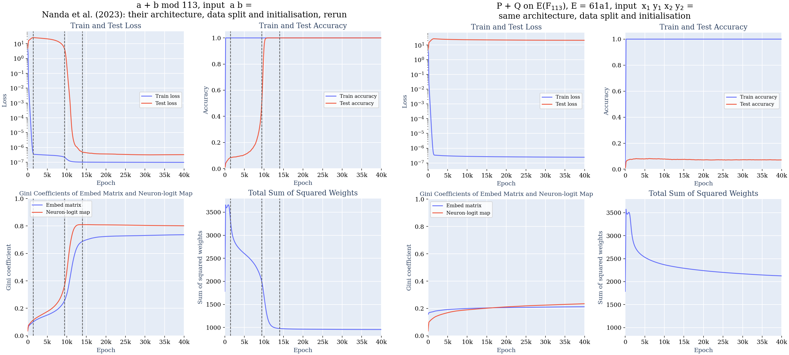
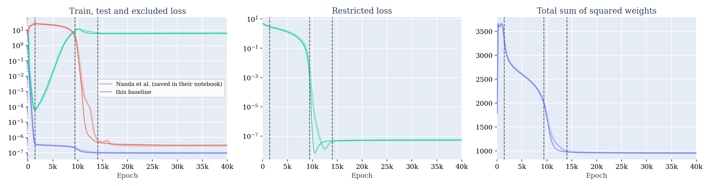

# Grokking the group law of an elliptic curve

Nanda et al. (2023) trained a one-layer transformer on $a + b \bmod 113$ and showed that it groks: it first memorises the training pairs, then generalises, and the final model computes the answer with a small set of Fourier frequencies. This repository runs the same experiment on the group of points of an elliptic curve over $\mathbb{F}_{113}$, changing only the input encoding.

**Result.** With Nanda et al.'s architecture, optimiser, data split and initialisation, the elliptic-curve model memorises the training set and does not generalise within 40,000 epochs.



Left: Nanda et al.'s setup on $a + b \bmod 113$, rerun with the code in this repository; the dashed lines are their phase boundaries (1.4k, 9.4k, 14k). Right: the same model, initialisation and train/test split, trained on $P + Q$ in $E(\mathbb{F}_{113})$ with points given by their coordinates. For the right-hand model, "embed matrix" means the matrix whose column $n$ is $(W_E[x(nG)], W_E[y(nG)])$; see [Measures](#measures).

## Why coordinates

If each point of $E(\mathbb{F}_p)$ is given to the network as its own token, the task is addition in a finite abelian group with the tokens relabelled. The embedding is a lookup table, so basically the experiment reduces to that of Nanda et al. (for $\mathbb{Z}/113$) or Chughtai et al. (2023) (for $C_n$) again. The task differs only when the network is given the coordinates of the points.

## Setup

**The curve.** $E$ is the curve [61a1](https://www.lmfdb.org/EllipticCurve/Q/61/a/1). It has good reduction at 113 and $a_{113} = 1$, so $\#E(\mathbb{F}_{113}) = 113 + 1 - a_{113} = 113$, and $E(\mathbb{F}_{113}) \cong \mathbb{Z}/113$. Over $\mathbb{F}_{113}$ the code uses the short Weierstrass model

$$y^2 = x^3 + 93x + 20,$$

in which $-(x, y) = (x, -y)$, and the generator $G = (1, 1)$. `make_curve_table.sage` produces `data/e61a1_f113_points.csv`, the 113 points sorted by discrete logarithm $\log_G P$, and checks that $\log_G(P + Q) = \log_G P + \log_G Q \bmod 113$ for all $113^2$ pairs.

**The tasks.**

| | $a + b \bmod 113$ (Nanda et al.) | $P + Q$ in $E(\mathbb{F}_{113})$ |
|---|---|---|
| input | `a b =` | `x1 y1 x2 y2 =` |
| input tokens | 0–112, `=` | 0–112 as elements of $\mathbb{F}_{113}$, `=`, `inf` for the point at infinity |
| output | 114 logits; the label is $a + b \bmod 113$ | 114 logits; the label is $\log_G(P + Q)$ |
| data | all $113^2$ pairs $(a, b)$ | all $113^2$ pairs $(aG, bG)$ |
| training set | 30%, Nanda et al.'s split | $(aG, bG)$ is a training pair exactly when $(a, b)$ is |

**Everything else** is taken from Nanda et al.'s code ([progress-measures-paper](https://github.com/mechanistic-interpretability-grokking/progress-measures-paper), `transformers.py`):

- one layer, $d_{model} = 128$, 4 attention heads of dimension 32, 512 ReLU neurons, causal attention mask;
- no LayerNorm, separate embedding and unembedding, learned positional embeddings;
- the parameter initialisations of their code, in the same order;
- AdamW with learning rate $10^{-3}$, weight decay 1, betas (0.9, 0.98); learning rate warmup $\min(s/10, 1)$ at step $s$;
- full batch, 40,000 epochs, cross-entropy at the last position over all outputs;
- the split: Python's `random.seed(0)` and `random.shuffle` on the pairs in lexicographic order.

Their code computes the training loss in float32 (`helpers.py`) and their analysis notebook in float64; this repository uses float64.

**Initialisation.** Their code does not set a seed for the model. With `torch.manual_seed(0)` before building the model, the initial train loss, test loss and sum of squared weights are 4.7552, 4.7595 and 1783.378, which are the values at epoch 0 saved in their analysis notebook. The elliptic-curve model copies every parameter of this initialisation. The new parameters are the embedding of the token `inf` and the positional embeddings of $y_1$ and $y_2$; the positions of $x_1$, $x_2$ and `=` take the positional embeddings of $a$, $b$ and `=`.

**Check of the baseline.** The $a + b \bmod 113$ run reproduces the curves saved in Nanda et al.'s notebook (thin lines: this repository; thick lines: their notebook) and has their key frequencies 14, 35, 41, 42, 52. During the clean-up phase (9.4k to 14k) the test loss of this run falls somewhat faster.



## Results

Both models reach train accuracy 1 by epoch 200. At the last checkpoint:

| epoch 39,900 | $a + b \bmod 113$ | $E(\mathbb{F}_{113})$ |
|---|---|---|
| test accuracy | 1.00 | 0.07 |
| test loss | $3 \cdot 10^{-7}$ | 20.5 |
| Gini coefficient, embed matrix | 0.74 | 0.21 |
| Gini coefficient, neuron-logit map | 0.80 | 0.23 |
| sum of squared weights | 956 | 2,125 |

For the elliptic-curve model, the test loss, the Gini coefficients and the sum of squared weights are still changing at epoch 40,000, slowly: from epoch 20,000 to 39,900 the test loss goes from 21.3 to 20.5 and the sum of squared weights from 2,239 to 2,125.

Not tested: longer training, a larger training fraction, other seeds, other curves or primes.

## Measures

The measures follow Nanda et al.'s analysis notebook, with logits taken at the last position and restricted to the first 113 outputs.

- We provide the **Gini coefficients** of the norms of the 113 Fourier components of the embedding and of the neuron-logit map $W_L = W_U^\top W_{out}$ (Fourier transform over the output). Nanda et al. do not publish the code for these; this is the definition in their Section 5.1. For the elliptic-curve model the embedding is indexed by field elements, not by group elements, so the Fourier transform over the group does not apply to it directly. The figure uses the matrix whose column $n$ is the concatenation $(W_E[x(nG)], W_E[y(nG)])$, Fourier transformed over $n$. Because $x(-P) = x(P)$, the $x$ half has no sine components; this is why its Gini coefficient is 0.16 at initialisation, against 0.04 for the baseline.
- **Excluded and restricted loss** are not shown. They depend on the key frequencies, which Nanda et al. read off the final model. For the elliptic-curve model, which has not grokked, their procedure returns 34 frequencies, each explaining 4–12% of the activation of its neurons, and the resulting restricted loss (0.01) does not indicate a working algorithm. `progress_measures.py` still computes both.

## What a solution would look like

If the model learned the group law as it does in the modular case, it would use the characters

$$\chi_k(P) = e^{2\pi i k \log_G P / 113}.$$

Since $-(x, y) = (x, -y)$ and $\chi_k(-P) = \overline{\chi_k(P)}$, the real part $\cos(2\pi k \log_G P / 113)$ is a function of $x$ alone, and the imaginary part is an odd function of the point, so its sign depends on $y$. To use the Fourier algorithm, the model first has to compute these functions of $\log_G P$ from the coordinates.

## Question

What architecture would grok this task? I'm not sure, and would welcome input here.

## Reproducing

Requirements: Python 3 with PyTorch, NumPy and Matplotlib (`requirements.txt`). SageMath is needed only to regenerate the curve table, which is included.

```bash
sage make_curve_table.sage                # optional: regenerates data/e61a1_f113_points.csv
python transformer.py modadd              # baseline, about 35 minutes on an Apple M-series CPU
python transformer.py ec mps              # elliptic curve; device argument optional
python progress_measures.py               # measures for both runs
python compare.py                         # figures/
```

Checkpoints are written to `checkpoints/` every 100 epochs and are not included in the repository.

| file | contents |
|---|---|
| `transformer.py` | model, data and training loop |
| `progress_measures.py` | key frequencies, excluded and restricted loss, Gini coefficients, weight norm |
| `compare.py` | the two figures |
| `make_curve_table.sage` | points of $E(\mathbb{F}_{113})$ and their discrete logarithms |
| `data/e61a1_f113_points.csv` | that table |
| `data/nanda2023_fig7_traces.json` | the Figure 7 curves saved in Nanda et al.'s analysis notebook |

## References

- N. Nanda, L. Chan, T. Lieberum, J. Smith, J. Steinhardt. *Progress measures for grokking via mechanistic interpretability.* ICLR 2023. [arXiv:2301.05217](https://arxiv.org/abs/2301.05217). Code: [progress-measures-paper](https://github.com/mechanistic-interpretability-grokking/progress-measures-paper).
- B. Chughtai, L. Chan, N. Nanda. *A toy model of universality: reverse engineering how networks learn group operations.* ICML 2023. [arXiv:2302.03025](https://arxiv.org/abs/2302.03025).
- N. Hurley, S. Rickard. *Comparing measures of sparsity.* IEEE Transactions on Information Theory 55 (2009). [arXiv:0811.4706](https://arxiv.org/abs/0811.4706).
- N. P. Smart. *The discrete logarithm problem on elliptic curves of trace one.* Journal of Cryptology 12 (1999).
